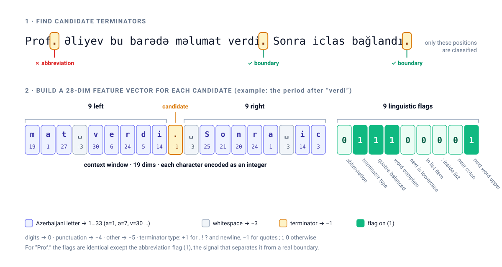
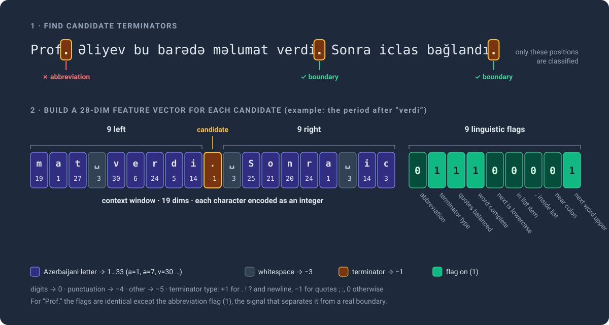
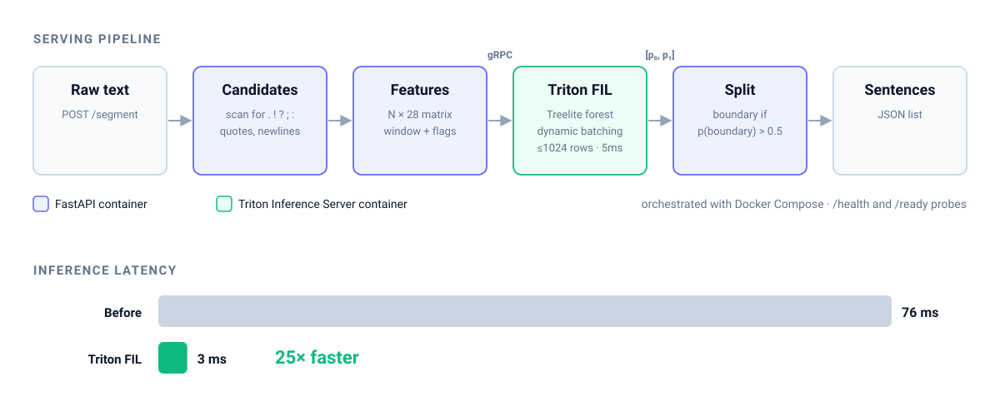
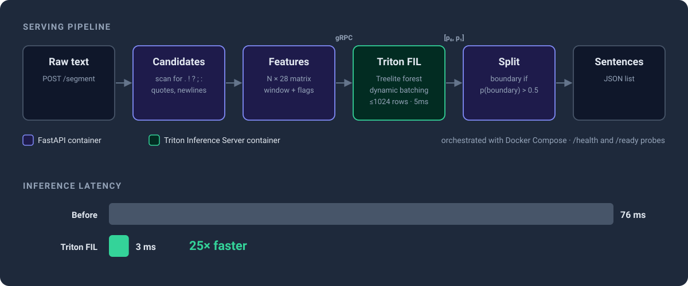

*Status: **Complete** · Nov 2025 – Jan 2026 · [GitHub](https://github.com/muradbaghirli/SentenceBoundaryDetection)*

<style>
.dark .dark-img { display: block; }
.dark .light-img { display: none; }
.dark-img { display: none; }
.light-img { display: block; }
</style>

## TL;DR

I built a sentence boundary detector specialized for **Azerbaijani legal text**, not general-purpose prose. It is a random forest classifier that decides, for every candidate terminator character (`.`, `!`, `?`, `;`, quotes, newlines…), whether a sentence actually ends there. Each candidate is described by a 19-character context window plus 9 engineered linguistic and punctuation features. The model reaches **0.958 F1** on boundary detection.

For serving, I compiled the forest with Treelite and deployed it on **NVIDIA Triton Inference Server (FIL backend)** behind a FastAPI service. Inference latency dropped from **76ms to 3ms, a 25× speedup**.

---

## Problem: Why Legal Text Breaks Sentence Splitters

Sentence splitting is the first step of almost every NLP pipeline (chunking for retrieval, summarization, translation), and errors here propagate everywhere downstream. Legal documents are the hardest case: laws, regulations, court decisions and contracts are dense with abbreviations, numbered clauses, nested lists and citations. Splitting on `.` breaks immediately on Azerbaijani legal text:

- **Abbreviations**: `prof.`, `məs.`, `mln.`, `kv.m.`, `Ph.D.`, initials like `Ə.M.`, Roman numerals like `XIV.`
- **Enumerations**: `1.`, `a)`, `(iii)`, bullet symbols, and lists introduced by legal formulas like *"aşağıdakılar müəyyən edilir:"* ("the following are established:") or *"tərəflər aşağıdakılar barədə razıdır:"* ("the parties agree on the following:")
- **Quotes**: a closing quote may or may not end the sentence, depending on balance and what follows
- **Semicolons and colons**: they end clauses inside lists, but sometimes end sentences

General-purpose splitters are tuned for English, everyday prose and Wikipedia-style text. They miss both Azerbaijani-specific abbreviations and the structure of legal documents. Neural models would handle this, but they are overkill in cost and latency for a step that runs on every document.

---

## Approach: Character-Level Classification

The design follows the structure of the [CharBoundary](https://github.com/alea-institute/charboundary) library, adapted for Azerbaijani.




**1. Candidate detection.** Only characters that *could* end a sentence are classified. Everything else is skipped, so the model sees a small fraction of the text.

**2. Character encoding.** Each character is mapped to an integer by type: Azerbaijani letters (all 33, including `ə`, `ğ`, `ı`, `ş`, `ç`, `ö`, `ü`) get their own IDs; digits, terminators, whitespace, punctuation and other characters get category codes.

**3. Feature vector (28 dims)** for each candidate position:

| Features | Dims | Description |
|---|---|---|
| Context window | 19 | Encoded characters, 9 to the left + the candidate + 9 to the right |
| Abbreviation flag | 1 | Token ending at this period is in an 830+ entry Azerbaijani abbreviation list |
| Terminator type | 1 | +1 primary (`. ! ?` newline), −1 secondary (quotes, `;`, `:`), 0 otherwise |
| Quote balance | 1 | Are straight and curly quotes balanced up to this point? |
| Word completion | 1 | Does a closing quote look like it ends a word? |
| Followed by lowercase | 1 | Next character is lowercase, a strong "not a boundary" signal |
| In list item | 1 | Near a list marker (`1.`, `a)`, `(ii)`, `•`…) or list conjunction (`və`, `və ya`, `həmçinin`…) |
| Semicolon in list | 1 | `;` separating list items rather than sentences |
| Near colon | 1 | Proximity to a list-introducing colon |
| Next word uppercase | 1 | Next word starts with a capital letter |

**4. Classifier.** A random forest (128 trees, max depth 32) trained on labeled Azerbaijani text. Training and evaluation use a 0.75 probability threshold, which favors precision: a missed split is cheaper downstream than a wrong one.

**5. Preprocessing.** Training text is normalized first: Cyrillic and Greek look-alike characters are mapped to Latin (`а → a`, `ә → ə`), and chunks with characters outside the Azerbaijani alphabet are dropped.

---

## Serving: Triton FIL

The random forest in scikit-learn was the latency bottleneck at **76ms**. The fix was to stop running it in Python:

1. **Treelite compilation.** The trained forest is converted to a Treelite checkpoint.
2. **Triton FIL backend.** Triton's Forest Inference Library runs tree ensembles natively on NVIDIA GPUs (or CPU) and returns class probabilities.
3. **Dynamic batching.** Triton merges concurrent requests into batches of up to 1,024 candidates, with a 5ms max queue delay.
4. **FastAPI front end.** The API extracts features, calls Triton over gRPC, and splits the text at positive predictions.

Result: **76ms → 3ms (25×)**.

 0.5 → sentences. Latency drops from 76ms to 3ms, 25× faster." style="max-width:100%;height:auto;" />
 0.5 → sentences. Latency drops from 76ms to 3ms, 25× faster." style="max-width:100%;height:auto;" />

The whole stack runs under Docker Compose: Triton plus the API, with health checks that separate liveness (`/health`) from readiness (`/ready`, meaning Triton is reachable and the model is loaded).

```bash
curl -X POST http://localhost:8000/segment \
  -H 'Content-Type: application/json' \
  -d '{"text": "Bu birinci cümlədir. Bu isə ikinci cümlədir."}'
```

---

## Results

| Metric | Value |
|---|---|
| Boundary F1 | **0.958** |
| Latency (scikit-learn) | 76ms |
| Latency (Triton FIL) | **3ms** |
| Speedup | **25×** |
| Feature vector | 28 dims |
| Model | Random forest, 128 trees, depth 32 |

---

## Team

Built together with [Turan Abbasli](https://www.linkedin.com/in/turan-abbasli/) and [Rashad Mammadov](https://www.linkedin.com/in/rashad-mammadov1/).

---

## Stack

`Python` · `scikit-learn` · `NumPy` · `Treelite` · `NVIDIA Triton Inference Server (FIL)` · `gRPC` · `FastAPI` · `Docker Compose`

---

*Code on [GitHub](https://github.com/muradbaghirli/SentenceBoundaryDetection).*
